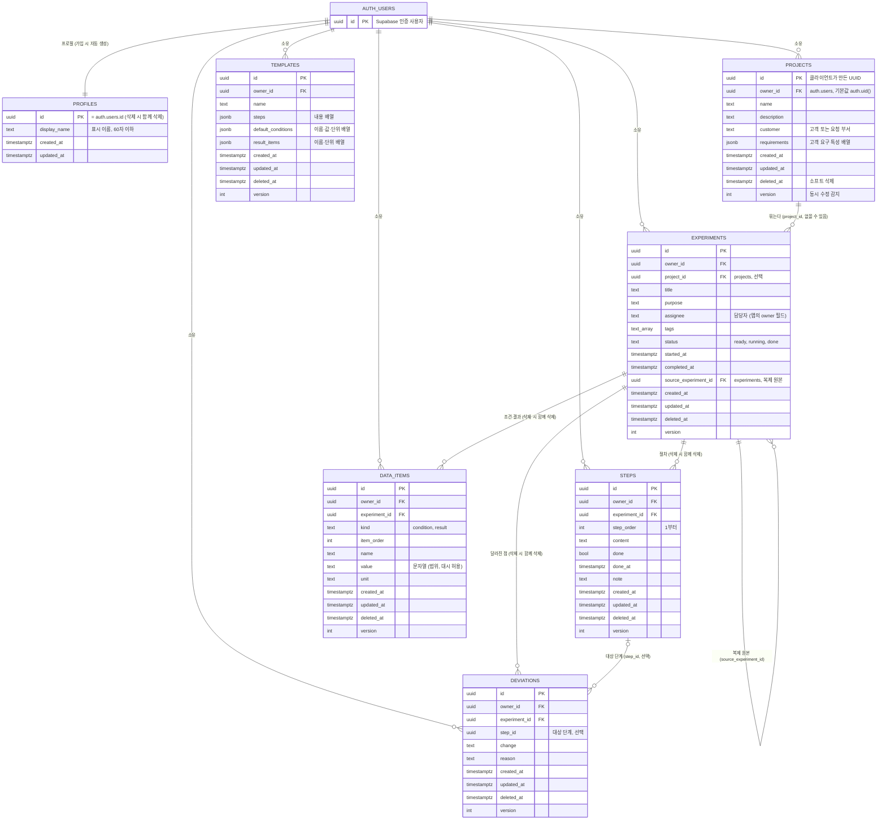
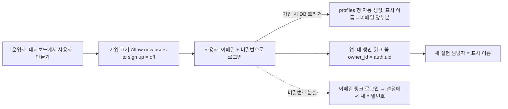

# 데이터베이스 설계 (ERD)

> **v2**: 표 구조는 lablog v1과 같다(7표). v2 전용 Supabase 프로젝트 `lablog-v2`(ref `wqemjezcdakwrjuztdlt`, 서울)에 같은 마이그레이션 두 개를 적용했고 보안 점검 0건, 사용자 A·B 격리 시험을 통과했다. 용어는 `GLOSSARY.md`(담당자 `assignee`, 소유자 `owner_id`)를 따른다. 구조를 바꿀 때는 새 마이그레이션과 이 문서를 같은 커밋에서 고친다.

> **제품 방향 메모(2026-10-20)**: spec 002에서는 템플릿 UI와 새 템플릿 생성을 제거하고 실제 이전 실험의 이어받기를 강화한다. 기존 `templates` 행과 백업 호환은 유지하며 표를 삭제하지 않는다. `결론`·`다음 행동` 필드는 사용자 승인 전에는 추가하지 않는다.

대상: Supabase(Postgres). 스키마 파일은 `supabase/migrations/20261020000000_init.sql`(기록 표)과 `20261020000100_profiles.sql`(프로필)이고, 앱의 도메인 모델(`app/src/domain/types.ts`)과 같은 모양이다.
문서와 SQL이 다르면 SQL이 맞다. 바꿀 때는 새 마이그레이션 파일을 추가하고 이 문서도 같이 고친다.

## ERD

## 로그인 설계

`grill-with-docs` 방식으로 한 질문씩 정하고 답을 남긴 결과다. 목표는 "개인용, 단순하게"다.

| 질문 | 결정 | 이유 |
|---|---|---|
| 누가 쓰나 | **개인용.** 내 데이터는 나만 본다 | 파일럿이 1명이다. 팀 공유는 아래 "팀 공유로 넓힐 때" |
| 로그인 방식 | **이메일 + 비밀번호**, 보조로 **이메일 링크** | 이미 구현돼 있고 외부 로그인 제공자 설정이 필요 없다 |
| 가입 | **닫는다.** 운영자(나)가 Supabase 대시보드에서 사용자를 만든 뒤 가입을 끈다 | 공개 주소에 앱이 올라가도 아무나 계정을 못 만든다 |
| 가입 버튼 | 기본은 숨김. `VITE_ALLOW_SIGNUP=true`일 때만 보인다 | 닫힌 서비스에 맞는 화면. 서버 설정과 별개로 화면 혼란을 막는다 |
| 비밀번호 분실 | 이메일 링크로 들어와 **설정 화면에서 새 비밀번호**를 정한다 | 전용 화면을 따로 만들지 않는다 |
| 로그인 유지 | **로그아웃할 때까지.** 토큰은 자동 갱신 | 실험실에서 매번 로그인하지 않게 |
| 프로필 | **표시 이름만.** 새 실험의 담당자 칸을 이 이름으로 미리 채운다 | 역할·소속 등은 지금 필요 없다 |
| 계정·데이터 삭제 | 앱에는 두지 않는다. 백업 후 대시보드에서 | 탈퇴는 드물고 위험하다. 사용자를 지우면 `on delete cascade`로 데이터도 함께 지워진다 |

### 흐름

### 용어

- **사용자(user)**: Supabase 인증의 `auth.users` 한 행. 지금은 한 사람 = 한 계정.
- **프로필(profile)**: 사용자의 표시 이름을 담은 행. 사용자와 1:1이고 본인만 읽고 고친다.
- **소유자(owner)**: 데이터 행의 `owner_id`. 앱의 "담당자"(`assignee`)와는 다르다. 소유자는 접근 권한이고, 담당자는 실험에 적는 사람 이름이다.

### 보안 규칙

- `profiles` RLS: `id = auth.uid()`인 행만 읽기·쓰기. `anon`은 권한 없음. 행 삭제 권한은 없다(사용자 삭제로만 사라진다).
- 프로필 생성 트리거 함수는 `security definer`이고 `search_path`를 비워 두며, 일반 사용자가 직접 호출할 수 없다.
- 앱에는 공개용 키만 넣는다. 가입을 닫아도 키는 공개될 수 있으므로 데이터 보호는 RLS가 맡는다.
- SQL: `supabase/migrations/20261020000100_profiles.sql`.

### 운영자가 할 일

1. Supabase **Authentication → Users → Add user**로 사용자(이메일, 비밀번호)를 만든다(**Auto Confirm User** 체크).
2. **Authentication → Sign In / Providers → Allow new users to sign up**을 끈다.
3. 비밀번호를 잊으면: 로그인 화면의 "이메일 링크로 로그인" → 메일의 링크 → 설정 → 비밀번호 변경.

## 표별 설명

| 표 | 역할 | 비고 |
|---|---|---|
| `profiles` | 사용자의 표시 이름 | `id`가 `auth.users.id`. 가입 시 트리거가 만든다 |
| `projects` | 맡은 프로젝트와 고객, 고객 요구 특성 | 요구는 `requirements`(jsonb)에 배열로 둔다. 항목 이름, 단위, 조건(이상·이하·범위·목표값), 적용 조건, 필수/희망을 담는다. 요구는 프로젝트와 함께만 읽고 쓰며 따로 검색하지 않아서 별도 표로 나누지 않았다 |
| `experiments` | 실험 한 건 | 프로젝트에 속하지 않을 수 있다. `source_experiment_id`는 복제한 실험의 원본 |
| `steps` | 실험의 절차 | `step_order`로 순서를 정한다(`order`는 SQL 예약어라 이름을 바꿨다) |
| `data_items` | 조건과 결과 값 | 같은 표에 `kind`로 구분한다. 값은 문자열이고 숫자 해석은 앱이 한다 |
| `deviations` | 절차와 달라진 점 | `step_id`는 선택. 단계가 지워져도 기록은 남는다(외래 키를 걸지 않았다) |
| `templates` | 표준 절차 묶음 | 절차·조건·결과 항목을 jsonb로 둔다. 실험과 연결되지 않는다 |

## 앱 필드와 열 이름

앱은 camelCase, DB는 snake_case다. 변환은 `app/src/data/supabase/mapping.ts` 한 곳에서 한다.

| 앱 | DB |
|---|---|
| `createdAt`, `updatedAt`, `deletedAt` | `created_at`, `updated_at`, `deleted_at` |
| `projectId`, `experimentId`, `stepId` | `project_id`, `experiment_id`, `step_id` |
| `sourceExperimentId` | `source_experiment_id` |
| `startedAt`, `completedAt` | `started_at`, `completed_at` |
| `Experiment.owner`(담당자) | `assignee` |
| `Step.order`, `DataItem.order` | `step_order`, `item_order` |
| `Template.defaultConditions`, `resultItems` | `default_conditions`, `result_items` |

## 설계 결정

1. **id는 클라이언트가 만든 UUID를 그대로 쓴다.** 로컬에서 쓰던 id를 유지해 이전을 다시 실행해도 중복되지 않고(멱등), 오프라인에서 만든 기록도 충돌 없이 올라간다.
2. **삭제는 `deleted_at`.** 휴지통(30일)과 동기화를 위해 물리 삭제를 하지 않는다. 영구 삭제는 휴지통에 있는 실험을 `purge`할 때만 하고, 딸린 단계·조건·결과·달라진 점은 외래 키의 `on delete cascade`로 함께 지운다.
3. **`version`으로 동시 수정을 감지한다.** 수정은 `where id = ? and version = ?`로 하고, 0행이 바뀌면 다른 곳에서 먼저 고친 것이라 충돌로 처리한다(앱의 `ConflictError`).
4. **모든 표에 `owner_id`가 있고 RLS가 자기 행만 허용한다.** 자식 표에도 `owner_id`를 두고 `(부모 id, owner_id)` 복합 외래 키를 걸었다. 그래서 다른 사람의 실험 id를 알아도 내 이름으로 자식 행을 끼워 넣을 수 없다.
5. **`anon`(로그인 안 한 사용자)에게는 권한이 없다.** 앱에 넣는 키(anon 키)는 공개돼도 되는 키이고, 데이터는 RLS와 로그인으로 지킨다. service_role 키는 절대 앱에 넣지 않는다.
6. **태그는 `text[]`.** 이름 변경·병합이 필요해지면 그때 표로 나눈다.
7. **첨부 파일은 이 스키마에 없다.** 필요해지면 Storage 버킷(`{owner_id}/{experiment_id}/{file}`)과 `attachments` 표를 추가한다.

## 인덱스

- `experiments(owner_id, status, updated_at desc)`: 홈의 진행 중, 목록 필터
- `experiments(owner_id, project_id, updated_at desc)`: 프로젝트별 최근순
- `steps(experiment_id, step_order)`, `data_items(experiment_id, kind, item_order)`: 실험 상세
- 검색은 지금 앱이 읽어 온 데이터를 메모리에서 찾는다. 데이터가 수천 건을 넘으면 `pg_trgm`(부분 일치)이나 `tsvector` 열을 이 스키마에 더한다.

## 팀 공유로 넓힐 때

지금은 개인 소유(`owner_id = auth.uid()`)다. 팀 공유가 필요해지면 `teams`, `team_members` 표를 추가하고 정책을 "본인 또는 같은 팀"으로 확장한다. 앱 코드는 `owner_id`를 직접 쓰지 않아서(기본값이 `auth.uid()`) 정책만 바꾸면 된다.
